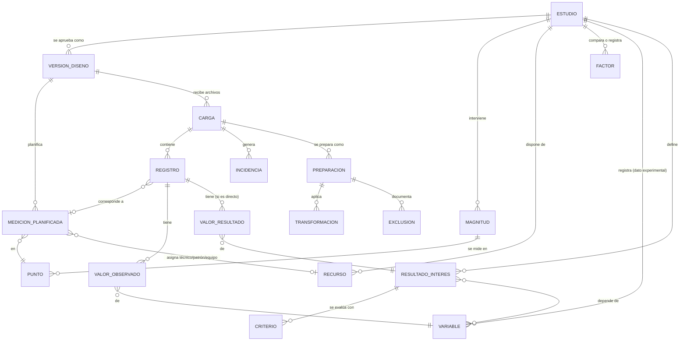
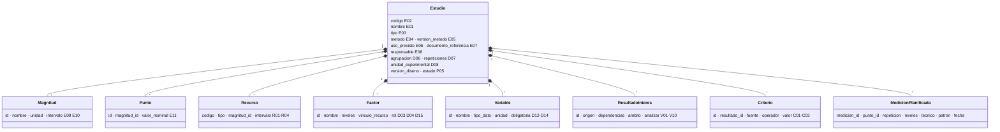

# Modelo de datos

Implementado hasta el nivel **lógico** (clases de Python) y **físico local** (archivos JSON + originales). El modelo físico en Supabase queda pendiente (PD15). Al final se propone su traducción a tablas.

## 1. Modelo conceptual

Sigue los componentes de la hoja «Flujo y relaciones» de la matriz.



Las decisiones clave:

- La **definición** de un dato o resultado está separada de su **valor**. Los valores viven en formato largo (una fila por valor), así que nunca hace falta una columna por resultado.
- Un resultado puede pertenecer a una medición, a una serie, a un punto, a un grupo o a todo el estudio (V07). Su valor se asocia a un *registro* (`registro_id`), que puede ser una medición (M0001) o un grupo (RD0001).
- La **versión del diseño** es la unidad de trazabilidad: plantillas, cargas y preparaciones apuntan a una versión inmutable con su huella.

## 2. Modelo lógico (implementado)

Las clases de `src/modelos/estudio.py`, que se detallan campo a campo en `01_diccionario_datos.md`:



Las entidades de datos (carga, registro, valores, incidencias, transformaciones) se representan como diccionarios JSON en `carga.json` y como tablas CSV en la salida (`09_salida_para_el_motor.md`).

## 3. Modelo físico local (implementado)

```text
datos_locales/estudios/<codigo>/
  borrador.json                    Estudio editable (JSON del modelo lógico)
  versiones/v001.json              {huella_diseno, estudio} · inmutable
  eventos.jsonl                    bitácora: fecha, usuario, acción, detalle (solo se agrega)
  cargas/<carga_id>/original.xlsx  archivo recibido, byte a byte
  cargas/<carga_id>/carga.json     lectura cruda + evaluación inicial + conteos + diferencias con la carga anterior
  preparaciones/<prep_id>/preparacion.json, conjunto_preparado.zip, informe_incidencias.xlsx
```

## 4. Propuesta de esquema para Supabase (no implementada)

Es la traducción directa del modelo. Se ejecutará cuando apruebes el diccionario (PD15).

| Tabla | Clave | Columnas principales | Relaciones |
| --- | --- | --- | --- |
| estudios | codigo | nombre, tipo, metodo, version_metodo, uso_previsto, documento_referencia, responsable, estado | — |
| versiones_diseno | (codigo, version) | huella_diseno, aprobado_por, fecha_aprobacion, configuracion jsonb | estudios |
| magnitudes, puntos, recursos, factores, niveles_factor, variables, resultados_interes, dependencias_resultado, criterios | (codigo, version, id) | campos del diccionario | versiones_diseno |
| mediciones_planificadas | (codigo, version, medicion_id) | punto_id, repeticion, tecnico, patron, equipo, fecha_planificada, orden | versiones_diseno, puntos |
| asignaciones_nivel | (codigo, version, medicion_id, factor_id) | nivel | mediciones_planificadas, factores |
| cargas | carga_id | codigo, version, fecha, usuario, archivo, sha256, estado_archivo, ruta_original (Storage) | versiones_diseno |
| registros | (carga_id, hoja, fila) | registro_id, estado, motivo_estado | cargas |
| valores_observados | (carga_id, registro_id, variable_id) | valor_numerico, valor_texto, valor_original | registros, variables |
| valores_resultado | (carga_id, registro_id, resultado_id) | valor, valor_original, ambito, grupo | registros, resultados_interes |
| incidencias, transformaciones, exclusiones | id | regla, severidad, celda, mensaje… | cargas / preparaciones |
| preparaciones | preparacion_id | carga_id, transformaciones_autorizadas, conteos jsonb, huellas jsonb, aprobada | cargas |
| eventos | id | codigo, fecha, usuario, accion, detalle jsonb | estudios |

Los archivos originales y los ZIP preparados irían en Supabase Storage. Las tablas guardarían su ruta y su SHA-256.
