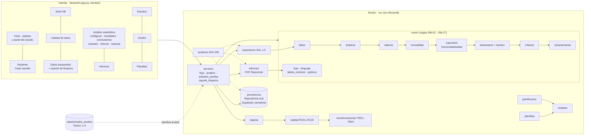

# Arquitectura

La interfaz solo pide datos, muestra resultados y llama servicios. La lógica de configuración, plantilla, ingesta, calidad, transformación, persistencia, exportación, motor estadístico e informes está en `src/`, que no importa Streamlit y puede ejecutarse desde Python (`ejemplos/flujo_completo.py`).

## Componentes

| Componente | Responsabilidad | No hace |
| --- | --- | --- |
| `src/modelos/estudio.py` | Clases del estudio y catálogos de valores. Cada atributo cita su campo de la matriz | Validar ni guardar |
| `src/configuracion/validacion_estudio.py` | Revisa por etapa qué falta (bloquea) y qué conviene revisar (advierte). Decide si el diseño puede aprobarse | Juzgar la idoneidad metrológica |
| `src/planificacion/plan.py` | Convierte el plan entre el editor y el modelo, importa CSV/Excel, genera combinaciones *solo si el usuario lo pide*, valida repeticiones, recursos, restricciones (D11) y compatibilidad patrón-punto, y calcula condición y grupo comparable | Crear un factorial automático |
| `src/plantillas/especificacion.py` | Una sola definición de las columnas de la plantilla, compartida por el generador y la ingesta | — |
| `src/plantillas/generador.py` | Genera el Excel: hojas, colores, validaciones de celda, protección, metadatos ocultos y huella | Generar desde un borrador |
| `src/plantillas/diligenciar.py` | Llena la plantilla por código, para construir escenarios sintéticos | Modificar columnas del sistema |
| `src/ingesta/lector.py` | Abre el archivo, identifica estudio, versión y huella, ubica columnas por encabezado y lee las filas conservando su fila de Excel | Interpretar ni corregir valores |
| `src/calidad/reglas.py` | Catálogo documentado de reglas (fuente de la matriz de reglas) | — |
| `src/calidad/evaluador.py` | Función pura: aplica reglas y transformaciones autorizadas, asigna estados y concilia conteos | Imputar, redondear o eliminar atípicos |
| `src/transformaciones/catalogo.py` | Transformaciones autorizables TR01–TR04 | Cambiar valores, signos o unidades |
| `src/servicios/flujo.py` | Orquesta la carga, la evaluación, la preparación y la aprobación (X05–X09) | — |
| `src/exportacion/salidas.py` | Construye las tablas normalizadas, el ZIP reproducible y el informe de incidencias | — |
| `src/exportacion/lector_salida.py` | Interfaz de entrada del motor: lee el ZIP y verifica las huellas | — |
| `src/persistencia/repositorio.py` | Contrato `Repositorio` + `RepositorioLocal` (JSON, originales, bitácora, escrituras atómicas) | Guardar credenciales |
| `src/motor/datos.py`, `limpieza.py` | Construye el objeto analizado (sin modificar valores) y revisa faltantes y réplicas por serie | Imputar |
| `src/motor/atipicos.py` | Grubbs por serie; Mandel, Cochran y Grubbs interlaboratorio (tablas ISO 5725-2:1994 en `tablas_iso.py`) | Borrar datos |
| `src/motor/normalidad.py`, `supuestos.py` | Shapiro-Wilk (residuos y promedios); Bartlett solo con normalidad; Fligner-Killeen informativo | Aplicar ANOVA sin normalidad |
| `src/motor/desempeno.py`, `fuentes.py` | Sesgo (t / Wilcoxon), s_r, s_I, s_R; fuentes de variación por la ruta ANOVA/Welch/Kruskal con post hoc | Decidir conformidad |
| `src/motor/criterios.py`, `caracteristicas.py` | Decisión frente a límites aprobados; consolidado y ruta verificación/validación | Inventar límites |
| `src/motor/motor.py`, `flujo.py`, `lenguaje.py`, `tablas_contexto.py`, `graficos.py`, `reglas.py` | Orquestación, sensibilidad, paso a paso, veredicto, lenguaje sencillo, tablas de contexto, gráficos, reglas RM-01…RM-27 | — |
| `src/informes/pdf.py` | Informe técnico y reporte de limpieza en PDF (ReportLab) | Recalcular |
| `src/servicios/analisis.py`, `estudios_prueba.py`, `reporte_limpieza.py` | Versiones del análisis, siembra de Testeo 1–4, reporte de limpieza | — |
| `interfaz/` | Páginas, estilo y utilidades de presentación | Contener lógica de negocio |

## Flujo del motor estadístico

El motor lee un conjunto **aprobado** (`cargar_conjunto(zip)`) y la configuración del análisis, y sigue el árbol de
decisión de `12_motor_reglas_y_arbol.md`: datos → atípicos → normalidad → (solo con normalidad) homocedasticidad →
prueba de la ruta → desempeño → criterios → veredicto. Guarda la memoria de cálculo completa en
`analisis/vNNN/resultado.json`; la interfaz y el PDF solo leen ese resultado.
