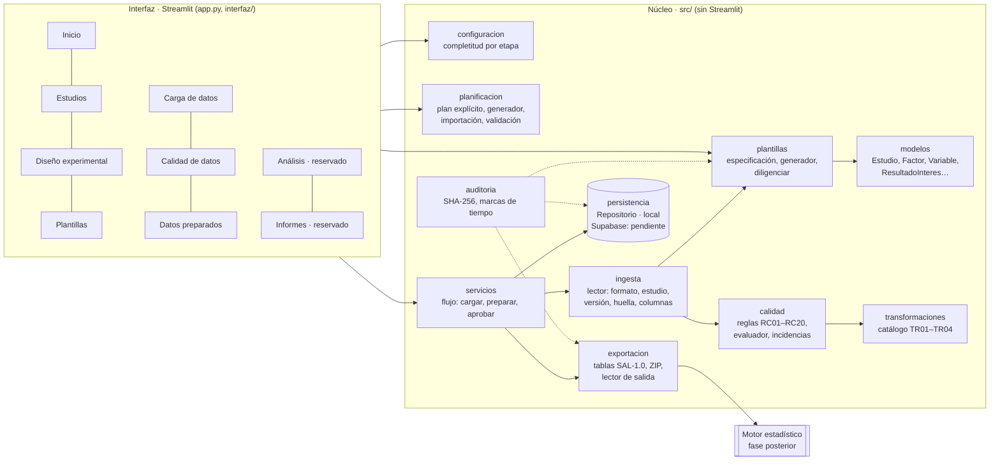

# Arquitectura

La interfaz solo pide datos, muestra resultados y llama servicios. La lógica de configuración, plantilla, ingesta, calidad, transformación, persistencia y exportación está en `src/`, que no importa Streamlit y puede ejecutarse desde Python (`ejemplos/flujo_completo.py`).

## Componentes

| Componente | Responsabilidad | No hace |
| --- | --- | --- |
| `src/modelos/estudio.py` | Clases del estudio y catálogos de valores. Cada atributo cita su campo de la matriz | Validar ni guardar |
| `src/configuracion/validacion_estudio.py` | Revisa por etapa qué falta (bloquea) y qué conviene revisar (advierte). Decide si el diseño puede aprobarse | Juzgar la idoneidad metrológica |
| `src/planificacion/plan.py` | Convierte el plan entre el editor y el modelo, importa CSV/Excel, genera combinaciones *solo si el usuario lo pide*, valida repeticiones, recursos, restricciones (D11) y compatibilidad patrón-punto, y calcula condición y grupo comparable | Crear un factorial automático |
| `src/plantillas/especificacion.py` | Una sola definición de las columnas de la plantilla, compartida por el generador y la ingesta | — |
| `src/plantillas/generador.py` | Genera el Excel: hojas, colores, validaciones de celda, protección, metadatos ocultos y huella | Generar desde un borrador |
| `src/plantillas/diligenciar.py` | Llena la plantilla por código, para construir escenarios sintéticos | Modificar columnas del sistema |
| `src/ingesta/lector.py` | Abre el archivo, identifica estudio, versión y huella, ubica columnas por encabezado y lee las filas conservando su fila de Excel | Interpretar ni corregir valores |
| `src/calidad/reglas.py` | Catálogo documentado de reglas (fuente de la matriz de reglas) | — |
| `src/calidad/evaluador.py` | Función pura: aplica reglas y transformaciones autorizadas, asigna estados y concilia conteos | Imputar, redondear o eliminar atípicos |
| `src/transformaciones/catalogo.py` | Transformaciones autorizables TR01–TR04 | Cambiar valores, signos o unidades |
| `src/servicios/flujo.py` | Orquesta la carga, la evaluación, la preparación y la aprobación (X05–X09) | — |
| `src/exportacion/salidas.py` | Construye las tablas normalizadas, el ZIP reproducible y el informe de incidencias | — |
| `src/exportacion/lector_salida.py` | Interfaz de entrada del motor: lee el ZIP y verifica las huellas | — |
| `src/persistencia/repositorio.py` | Contrato `Repositorio` + `RepositorioLocal` (JSON, originales, bitácora, escrituras atómicas) | Guardar credenciales |
| `interfaz/` | Páginas, estilo y utilidades de presentación | Contener lógica de negocio |

## Punto de conexión con el motor estadístico

El motor recibirá un conjunto **aprobado** y lo leerá con `cargar_conjunto(zip)`. No necesita conocer la plantilla Excel ni la interfaz. Cuando se defina, un módulo `src/motor/` podrá:

1. leer `definiciones_resultados.csv` para saber qué resultados calcular (origen = calculado) y de qué datos dependen;
2. calcular esos resultados y guardarlos en el mismo formato largo que `resultados_valores.csv`, con `origen = calculado`;
3. aplicar sus reglas de decisión usando `grupo_comparable`, `condicion` y las columnas `factor:<nombre>`.
