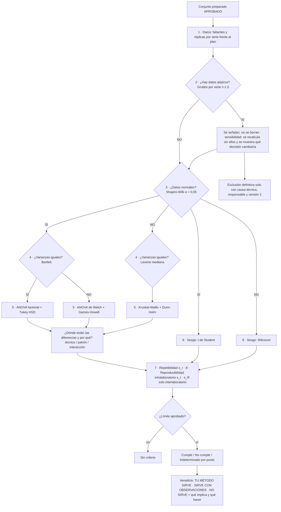

# Motor · matriz de reglas y árbol de decisión

## Árbol de decisión

## Matriz de reglas (RM-xx)

Generada desde `src/motor/reglas.py`; la misma tabla aparece en el anexo B del informe.

| Regla | Descripción | Origen | Referencia |
| --- | --- | --- | --- |
| RM-01 | Los datos originales no se modifican; el motor trabaja sobre una copia del conjunto preparado. | NORMA | ISO/IEC 17025:2017 §7.5 y §7.11 |
| RM-02 | No se imputan faltantes ni se reemplazan por cero; cada técnica comprueba su propia suficiencia. | COMPLEMENTARIA | Especificación §6 |
| RM-03 | El porcentaje de faltantes solo genera alerta si el laboratorio fija un umbral; no hay umbral universal. | CRITERIO_LAB | Especificación §6 |
| RM-04 | Cochran, Mandel y s_R solo en estudios interlaboratorio. | NORMA | ISO 5725-2:1994 §7.3 y §7.4 |
| RM-05 | Los técnicos u otras condiciones internas no se tratan como laboratorios. | NORMA | ISO 5725-1:1994 §3.18–3.20 |
| RM-06 | Las tablas críticas solo se aplican si la edición configurada es la implementada. | NORMA | ISO 5725-2:1994 |
| RM-07 | Cochran exige ≥ 2 celdas con réplicas; con n_ij distinto se usa el n mayoritario. | NORMA | ISO 5725-2:1994 §7.3.3 |
| RM-08 | Grubbs (norma) sobre medias de celda, p ≥ 3; doble p ≥ 4. | NORMA | ISO 5725-2:1994 §7.3.4 |
| RM-09 | Grubbs intralaboratorio solo sobre réplicas de una celda (n ≥ 3). | COMPLEMENTARIA | Grubbs (1969) |
| RM-10 | Ninguna exclusión sin motivo técnico, responsable, versión derivada y recálculo. | NORMA | ISO 5725-2:1994 §7.3.2 |
| RM-11 | El objeto de la normalidad depende del procedimiento. | COMPLEMENTARIA | Montgomery (2017) |
| RM-12 | p ≥ α se redacta «no se rechaza H0». | COMPLEMENTARIA | Especificación §11 |
| RM-13 | Ruta del sesgo: t / Wilcoxon / solo estimación. | COMPLEMENTARIA | Eurachem (2016) §6.5 |
| RM-14 | s_r: varianzas intracelda agrupadas. | NORMA | ISO 5725-2:1994 ec. 20 |
| RM-15 | s_I: ANOVA de efectos aleatorios; varianza entre negativa → 0. | COMPLEMENTARIA | Eurachem (2016) §6.6.4 |
| RM-16 | s_R² = s_L² + s_r²; s_L² negativo → 0. | NORMA | ISO 5725-2:1994 ec. 21–24 |
| RM-17 | Sin criterio aprobado completo → CALCULADO_SIN_EVALUACION. | NORMA | ISO/IEC 17025:2017 §7.8.6 |
| RM-18 | La no significación no demuestra equivalencia. | COMPLEMENTARIA | Especificación §9 |
| RM-19 | No se convierten unidades. | CRITERIO_LAB | Especificación §3 |
| RM-20 | Decisión inferencial, estimación y decisión metrológica separadas. | COMPLEMENTARIA | Especificación §9 |
| RM-21 | Ruta verificación / validación según el estado del método. | NORMA | Eurachem (2016) §4.2 |
| RM-22 | Dixon no implementado. | COMPLEMENTARIA | Dixon (1950) |
| RM-23 | Fuentes de variación por punto (técnico, patrón, interacción). | COMPLEMENTARIA | Montgomery (2017) |
| RM-24 | α = 0,05, 95 % y Shapiro-Wilk fijos; solo se configuran los límites. | COMPLEMENTARIA | Especificación del equipo |
| RM-25 | Cumple + normalidad rechazada → «cumple con observaciones». | COMPLEMENTARIA | Especificación del equipo |
| RM-26 | Ruta condicional ANOVA/Welch/Kruskal y post hoc Tukey/Games-Howell/Dunn; Bartlett o Levene según normalidad. | COMPLEMENTARIA | Montgomery (2017) |
| RM-27 | Atípicos: se señalan, se mide su efecto (sensibilidad) y la exclusión la decide una persona. | NORMA | ISO 5725-2:1994 §7.3.2 |
